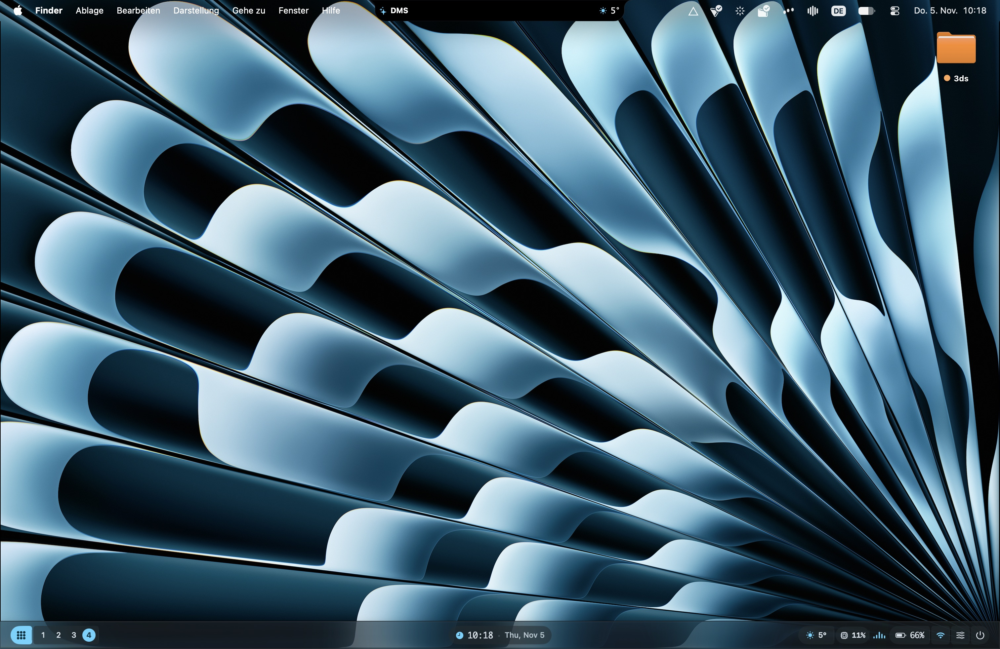
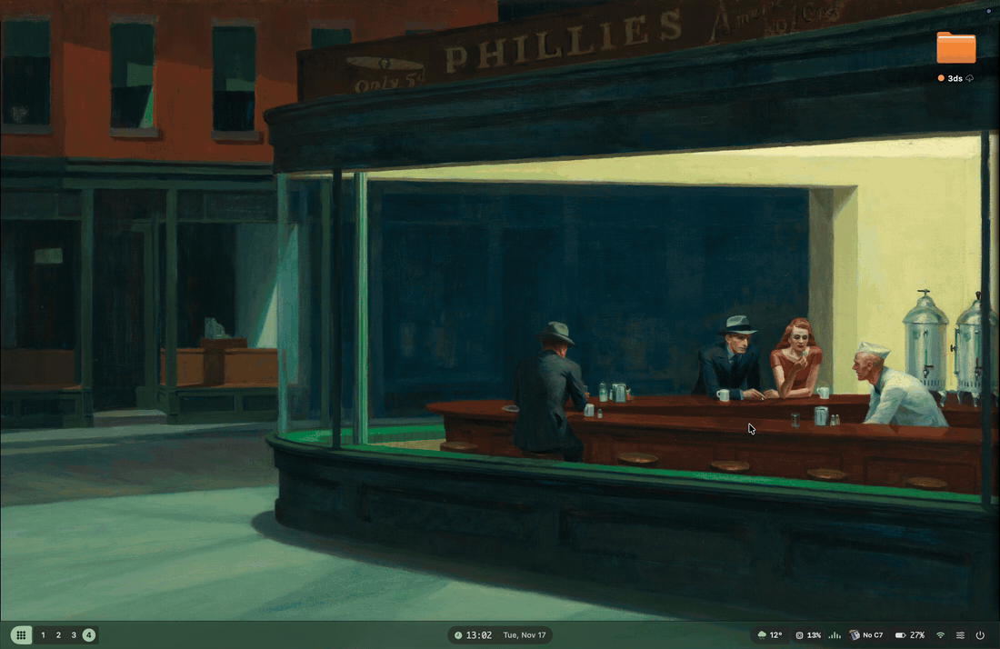
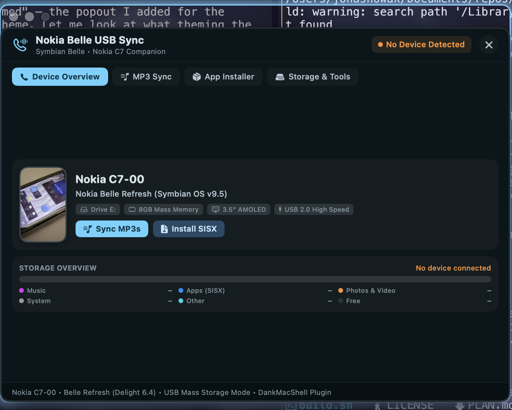

<h1 align="center">DankMacShell</h1>

<p align="center">
  <em>The Material 3 Expressive shell experience — natively on macOS.</em>
</p>

<p align="center">
  <a href="https://github.com/JonasNowak/DankMacShell/actions/workflows/build.yml"></a>
  <a href="https://github.com/JonasNowak/DankMacShell/releases"></a>
  <a href="https://github.com/JonasNowak/DankMacShell/blob/main/LICENSE"></a>
  
  
  <a href="https://github.com/OmniNull/OmniWM"></a>
</p>



## 📑 Contents

- [What is DankMacShell?](#what-is-dankmacshell)
- [Install](#install)
- [Features](#features)
- [Configuration](#configuration)
- [URL scheme (`dms://`)](#url-scheme)
- [Advanced topics](#advanced-topics)
- [Roadmap](#roadmap)
- [SymbianOS plugin](#symbianos-plugin)
- [Contributing](#contributing)
- [License](#license)

<a id="what-is-dankmacshell"></a>

## ✨ What is DankMacShell?

DankMacShell (DMS) is a native macOS shell written in Swift. It is highly inspired by [DankMaterialShell](https://github.com/AvengeMedia/DankMaterialShell). It brings the Linux window-manager "rice" experience (status bar, launcher, dashboard, dynamic Material You theming) to macOS. **This project is not affiliated with or endorsed by DankMaterialShell or AvengeMedia.**

It runs on **stock macOS** on its own. If you use the tiling window manager [OmniWM](https://github.com/OmniNull/OmniWM), DMS integrates with it for tiling, workspaces, and border sync, but OmniWM is optional, never required (without it, DMS falls back to native SkyLight spaces).

> **v0.9.0**: hardened pre-1.0 release with macOS 14+ support, locked-down IPC/URL scheme security, and full native widget/service wiring. Track problems in [Issues](https://github.com/JonasNowak/DankMacShell/issues).

<p align="center">
  
</p>

<a id="install"></a>

## 🚀 Install

### 🍺 1. Homebrew cask

```bash
brew tap jonasnowak/dankmac https://github.com/JonasNowak/DankMacShell.git
brew install --cask jonasnowak/dankmac/dankmacshell
brew services start dms-gop   # optional: companion REST API on 127.0.0.1:63484
```

The tap also ships the `dms-gop` and `dank-theme-engine` formulae the cask depends on. It is the best experience.

### ❄️ 2. Nix Flake

One flake input installs `DankMacShell.app`, `dms`, `dms-symbian`, `dms-gop` (`dgop`), and `dank-theme-engine` (`dte`) along with their `launchd` LaunchAgents:

#### a) Flake

```nix
{
  inputs.dankmacshell.url = "github:JonasNowak/DankMacShell";

  outputs = { self, nix-darwin, dankmacshell, ... }: {
    darwinConfigurations."my-mac" = nix-darwin.lib.darwinSystem {
      system = "aarch64-darwin";
      modules = [
        dankmacshell.darwinModules.default
        {
          programs.dankmacshell = {
            enable = true;
            launchd.enable = true;              # auto-start DankMacShell.app in the Aqua session
            dmsGop.server.enable = true;        # auto-start dms-gop REST API (127.0.0.1:63484)
            themeEngine.launchd.enable = false; # optional background `dte watch` agent
          };
        }
      ];
    };
  };
}
```

#### b) Home manager

```nix
{
  imports = [ inputs.dankmacshell.homeManagerModules.default ];

  programs.dankmacshell = {
    enable = true;
    themeEngine.targets = {
      kitty.enable = true;
      ghostty.enable = true;
      tmux.enable = true;
      neovim.enable = true;
    };
  };
}
```

### ⬇️ 3. Download the DMG (reduced experience)

- [ ] Download the latest DMG from [GitHub Releases](https://github.com/JonasNowak/DankMacShell/releases/latest) (currently `DankMacShell-0.9.0.dmg`)
- [ ] Open the DMG and drag **DankMacShell** into `/Applications`
- [ ] First launch: the DMG is not signed/notarized — right-click the app and choose **Open**, or run `xattr -cr /Applications/DankMacShell.app`, then grant Accessibility & Input Monitoring when prompted

> Note that it does not have all features, like native OSD suppression.

### 🔨 4. Build from source

```bash
git clone https://github.com/JonasNowak/DankMacShell.git
cd DankMacShell
./build.sh        # or: make build
```

You need macOS 14+ with Xcode or the Command Line Tools (Swift 6 toolchain); plain `swift build` works too — it's a Swift Package. Run the tests with `./test.sh`.

<a id="features"></a>

## 🧩 Features

At a glance:

| Component | Hotkey | TL;DR |
| --- | --- | --- |
| DankBar | — | Multi-edge Material 3 status bar |
| Dynamic Island (`DIsland`) | — | Spring-animated notch / floating pill |
| DLauncherV2 | `⌥Space` | App launcher, calculator, file search & `dmenu` |
| DankDash | `⌥D` | Dashboard: weather, calendar, media, lyrics, wellbeing |
| Control Center | — | Drag-and-drop grid tiles, sliders & detail pages |
| Native OSD | — | Floating volume/brightness pill with bezel suppression |
| Wallpaper Picker & Sync | `⌃⌥⇧⌘W` | Slanted carousel switcher & OmniWM border sync |
| Notepad | `⌥N` | Multi-note window with Markdown preview & Find/Replace |
| Clipboard History | `⌥V` | Searchable clipboard store with sensitive filtering |
| ProcessList | — | Activity-monitor-style task manager |
| ColorPicker | — | Screen eyedropper (`NSColorSampler`) |
| QR Generator | — | QR codes from text, URLs, or current Wi-Fi |
| Keybinds Cheatsheet | — | Searchable shortcuts reference dialog |
| Plugins & Applets | — | Built-in registry, lockfile (`plugins.lock.json`) & bar toggles |
| Settings | — | 20-tab configuration window across 7 categories |
| Dynamic Theming | — | Rust-backed M3 Expressive palettes from wallpaper or seed |

### 📊 DankBar — multi-edge status bar
Material 3 Expressive pill chips with dynamic tonal surfaces (`surface`, `glass`, `transparent`, `island`) and corner styles (`capsule`, `gothic`, `rounded`, `square`). Place bars on any of the four screen edges across multiple monitors via `barConfigs`, with notch-aware safe zones, fullscreen-aware `smartAutoHide`, and hover reveal.
- **35+ catalog widgets:** workspaces, running/focused app pills, clock, media + live LRC lyric ticker, audio visualizer, weather, CPU/RAM/GPU/disk/network, temperatures, battery, Wi-Fi, volume, mic, idle inhibitor, keyboard layout, caps lock, privacy, VPN, updates, tray, notifications, Control Center, power menu, and applet triggers.

### 🏝️ Dynamic Island (`DIsland`) & native OSD
An 8-DOF spring-solver surface in `mainBar`, `notch`, `float`, or `off` modes, with live compact pills and expandable panels for Home, Media (with lyrics), Weather, OSD, Notifications, Clipboard, Power, Control Center, and DankDash. It replaces the macOS volume/brightness bezel (`SystemOSDManager` + `MediaKeyInterceptor`) via event-tap swallowing, passive Input Monitoring, or a zero-permission CoreAudio fallback.

### 🔍 DLauncherV2 — launcher, calculator, file search & `dmenu`
Press `⌥Space` (customizable) anywhere. List or 5-column tile views with frecency scoring; an inline calculator (`24 * 60`, `sqrt(144)`, hex, trig/log) with web-search fallback; `file:`/`f:`/`/`/`~` prefixes search via Spotlight. The `Tab` action panel focuses, hides, quits, reveals, or edits apps (`apps.perApp`), and `dms dmenu` turns the launcher into a scriptable stdin picker.

### 📈 DankDash — dashboard
Press `⌥D` (customizable). Six tabs: **Overview** (clock, CPU/thermal/RAM gauges, weather, calendar, wellbeing, media card), **Media** (Apple Music/Spotify/VLC/web players with 10 Hz synchronized LRC lyrics from LRCLIB), **Weather** (Open-Meteo forecasts, sun arc, moon phases), **Wallpapers**, **Wellbeing** (Screen Time sync, app quotas, 92-day retention), and **Settings**.

### 🎛️ Control Center
Drag-and-drop tile grid — rearrange, resize (`1x1`, `2x1`, `4x1`), add/remove via the Tile Library, 50-step undo/redo. Twelve expressive avatar shapes, six detail pages (Wi-Fi, Bluetooth, Audio, Battery, DND, Idle Inhibit), quick tiles, and master Volume/Brightness sliders plus Night Shift and dark/light.

### 🖼️ Wallpaper browser, slanted switcher & OmniWM sync
Browse `~/Pictures`, system pictures, custom folders, and gradients in DankDash/Settings, or flip through the slanted carousel with `⌃⌥⇧⌘W` (`F` filter, `R` shuffle, `Esc` revert). `dms omniwm sync` writes M3 gradient border colors into `~/.config/omniwm/settings.toml` (with a `.dms-backup`).

### 📝 Notepad
Press `⌥N` (customizable). A normal, tileable macOS window with a multi-note sidebar, Markdown preview modes (`none`/`split`/`full`), Find & Replace (`⌘F`), and word/character counters. Notes persist in `~/Library/Application Support/DMS/notes.json`.

### 📋 Clipboard history
Press `⌥V` (customizable). Searchable text/URL history in `clipboard_history.json` (default `clipboardMaxItems: 200`) with keyboard navigation and optional synthetic `⌘V` auto-paste (Accessibility). Concealed/transient pasteboard types and copies from 1Password, Bitwarden, and KeePassXC are filtered out (`clipboardFilterSensitive`).

### ⚙️ ProcessList, power menu, ColorPicker, QR & keybinds
ProcessList shows live PID/CPU/RAM with search, sorting, and `SIGTERM`/`SIGKILL`. The power menu covers Lock/Sleep/Restart/Shut Down/Log Out with floating M3 toasts. ColorPicker is a native `NSColorSampler` eyedropper with HEX/RGB/HSL copy; the QR generator renders `CIQRCodeGenerator` codes (including one-click Wi-Fi QR) with PNG export; the keybinds cheatsheet is a searchable shortcuts modal.

### 🧩 Plugins, applets & Settings
Browse and install plugins from the built-in registry, lock/restore `plugins.lock.json`, and toggle DankBar applets. The Settings window organizes **20 tabs across 7 categories** (Personalization, Primary Bar, Widgets & Notifications, Keyboard Shortcuts, Power & Sleep, Plugins, About) with live subsystem diagnostics.

### 🌈 Dynamic & Expressive theming
The Rust-backed `DankThemeEngine` and `MaterialMacLibrary` generate full dark/light Material 3 tonal palettes from the active wallpaper or a custom hex seed, with selectable Matugen schemes (`tonalSpot`, `vibrant`, `expressive`, `fidelity`, `neutral`, `monochrome`) and contrast levels. Ships with **7 stock themes** (`purple`, `blue`, `green`, `orange`, `red`, `yellow`, `neutral`) and **6 community themes** (`catppuccin-mocha`, `catppuccin-latte`, `nord`, `gruvbox`, `tokyo-night`, `everforest`).

<a id="configuration"></a>

## ⚙️ Configuration

Settings are stored at:
`~/Library/Application Support/DMS/settings.json`

*(Legacy `~/Library/Application Support/DMS/config.json` files are automatically migrated on first launch and mirrored on save. Config fragment composition via `"$include": [...]` is also supported.)*

The configuration file is automatically created with defaults (`version: 2`) on first launch and hot-reloads immediately upon disk changes:

```json
{
  "version": 2,
  "theme": "purple",
  "isLightMode": false,
  "barConfigs": [
    {
      "id": "primary-bar",
      "name": "Primary Bar",
      "position": "bottom",
      "autoHide": false,
      "smartAutoHide": false,
      "backgroundStyle": "surface",
      "cornerStyle": "gothic",
      "adaptToNotch": true
    }
  ],
  "weatherLocation": "auto",
  "weatherUnits": "celsius",
  "webSearchProvider": "google",
  "launcherAttachment": "center",
  "clipboardFilterSensitive": true,
  "clipboardAutoPaste": false,
  "clipboardMaxItems": 200,
  "notepadPreviewMode": "none",
  "enableLyrics": true,
  "mediaPlayerLayout": "bento",
  "autoThemeOmniWM": true,
  "terminalThemeSync": true,
  "terminalThemeGhostty": true,
  "terminalThemeKitty": true,
  "terminalThemeAlacritty": true,
  "terminalThemeITerm2": false
}
```

<a id="url-scheme"></a>

## 🔗 URL Scheme (`dms://`)

DMS registers the `dms://` URL scheme for **safe UI toggle & navigation** actions:
- `open -g dms://toggleLauncher` (supports `?action=open&q=...`)
- `open -g dms://dash` (supports `?tab=overview|media|wallpapers|weather|wellbeing|settings`)
- `open -g dms://toggleControlCenter`
- `open -g dms://powerMenu` (`open` / `toggle` UI only)
- `open -g dms://notepad` (`open`, `close`, `toggle` UI only)
- `open -g dms://clipboard` (`open`, `close`, `toggle` UI only)
- `open -g dms://processlist` (`open`, `close`, `toggle` UI only)
- `open -g dms://colorpicker` (`open` / `toggle` UI only)
- `open -g dms://qr` (`open` / `toggle` UI only)
- `open -g dms://keybinds` (`open`, `close`, `toggle` UI only)
- `open -g dms://settings` (`open`, `close`, `toggle`, optional `?tab=...`)
- `open -g dms://bar/toggle` (`reveal`, `hide`)
- `open -g dms://island/toggle` (`expand?activity=home|media|notification|osd|dash|clipboard|weather`, `collapse`, `open`, `close`)
- `open -g dms://wallpaper/picker` (opens the wallpaper picker)

> [!NOTE]
> **Security boundary (v0.9.0+):** Destructive, state-mutating, and privileged actions (`processlist/kill`, `powermenu` Lock/Sleep/Restart/Shut Down/Log Out, `settings` writes, `clipboard`/`notepad` writes, `screenshot`, `plugins`, `symbian`, `dmenu`, and hardware controls) are rejected over `dms://`. Use the `dms` CLI (`0600` local socket) for automation.

<a id="advanced-topics"></a>

## 🧰 Advanced topics

<a id="global-hotkeys"></a>

### ⌨️ Global Hotkeys

All 5 global hotkeys are customizable in **Settings → Keyboard Shortcuts** (it supports hyper key):

| Action | Default Hotkey |
| --- | --- |
| Toggle DLauncherV2 (Spotlight launcher) | `⌥Space` |
| Toggle DankDash | `⌥D` |
| Toggle Notepad | `⌥N` |
| Toggle Clipboard History | `⌥V` |
| Toggle Slanted Wallpaper Picker | `⌃⌥⇧⌘W` (`Hyper+W`) |

<a id="dms-cli"></a>

### 🖥️ DMS CLI (`dms`)

A dedicated command-line utility is installed to `~/.local/bin/dms` for controlling the shell via Unix domain socket (`~/Library/Application Support/DMS/dms.sock`):

<details>
<summary><b>Full command reference</b></summary>

```bash
# General Management
dms start                        # Start DankMacShell app (alias: run)
dms run                          # Alias for 'dms start'
dms stop                         # Stop running DankMacShell
dms restart                      # Restart DankMacShell
dms status                       # Show running status of DMS daemon and socket
dms doctor                       # Run diagnostics check on permissions and subsystems
dms permission                   # Open Accessibility / Device Control settings to grant event swallowing
dms setup-cert                   # Create/trust persistent 'dms-cert' and re-sign DankMacShell.app for TCC persistence
dms reload                       # Reload configuration from disk
dms version                      # Show version info

# Windows, Overlays & App Control
dms spotlight [toggle|open|close]
dms launcher [toggle|open|close]
dms dash [toggle|open|close]
dms control-center [toggle|open|close]
dms powermenu [open|lock|sleep|restart|shutdown|logout]
dms notepad [toggle|open|close|get|set <text>|append <text>]
dms clipboard [toggle|open|list|clear|copy <text>]
dms processlist [toggle|open|list|kill <pid>]
dms unhide <bundleID> [--background]
dms unhide-all [--background]
dms hide <bundleID>
dms activate <bundleID>
dms colorpicker [pick]
dms qr [text]
dms keybinds [toggle|open|close]
dms settings [toggle|open [tab]|close|get <key>|set <key> <val>|dump]

# Bar, Island & Workspaces
dms bar [reveal|hide|toggle|status|setposition <top|bottom|left|right>]
dms island [toggle|open [activity]|close|expand [activity]|collapse|media|weather|status]
dms workspace [status|switch <num>|next|prev]

# Hardware, Media, Lyrics & Weather
dms audio [status|setvolume <0-100>|increment|decrement|mute|unmute|toggle|list-devices|set-device <name>]
dms mic [status|mute|unmute|toggle]
dms brightness [get|set <0-100>|increment|decrement]
dms inhibit [toggle|enable|disable|status]
dms mpris [status|play|pause|toggle|next|prev|seek <sec>|lyrics]
dms lyrics [status|current|refresh|clear-cache|offset <ms>]
dms weather [status|refresh|location <city|lat,lon>]
dms wellbeing [status|enable|disable|toggle|sync [true|false]|open-system|check]

# Themes, Wallpapers, OmniWM, Plugins & Companion
dms theme [get|set <name>|list|toggle-mode]
dms wallpaper [get|set <path>|list|picker|next|prev|random]
dms omniwm [get|sync|mode <mode>|direction <dir>|toggle]
dms plugins [search [query]|list|install <id>|uninstall <id>|enable <id>|disable <id>|lock|restore [path]]
dms applets [list|toggle <name>]
dms danksearch [status|diagnostics|reset|search <query>]
dms symbian [open|close|toggle|status|clean|eject|install <path>|sync]
dms screenshot [region|full|window]
dms toast <info|warn|error> <message>
dms ipc call <target> <action> [args...]

# CLI Pipelines (v0.7)
dms dmenu [--prompt <text>]     # Read candidates from stdin, pick one in the launcher, print it to stdout
                                 # (exit 0 on selection, exit 1 on Esc/cancel, exit 3 if daemon unreachable)
dms listen [topic]               # Stream newline-delimited JSON events from the daemon (default topic: *)
                                 # topics: events.audio, events.battery, events.wifi, events.workspaces,
                                 #         events.media, events.theme
dms shell                        # Interactive IPC REPL (dms> prompt, history in ~/.dms_shell_history,
                                 # tab-completion over the CLI vocabulary)
```

</details>

### `dms dmenu` — scriptable picker

```bash
printf 'alpha\nbeta\ngamma\n' | dms dmenu --prompt "Pick one"
# -> shows the launcher in filter mode; the chosen line is printed to stdout
```

Candidates are staged in `~/Library/Application Support/DMS/dmenu/<requestID>.txt` and only the
path + request ID travel over the socket, so the line protocol stays intact. The daemon writes the
selection back on the same connection (and to `<requestID>.result` as a fallback).

### `dms listen` — event stream

```bash
dms listen events.audio    # prints one JSON object per line until Ctrl-C
```

### `dms shell` — interactive IPC REPL

```bash
dms shell
dms> theme get
dms> audio setvolume 50
```

`dms.sock` also accepts `SUBSCRIBE <topic>` / `UNSUBSCRIBE <topic>` and single-line REST commands (`GET /api/v1/audio/volume`, `POST /api/v1/audio/volume`, `GET|POST /api/v1/audio/sinks`, `GET /api/v1/network/wifi/scan`, `POST /api/v1/network/wifi/connect`, `GET /api/v1/bluetooth/devices`, `POST /api/v1/brightness/set`, `GET /api/v1/settings`, `POST /api/v1/settings`).

<a id="terminal-themes"></a>

### 🖥️ Terminal Theme Sync & home-manager

When the DMS theme changes, the shell live-exports the current palette to your terminal emulators
(master switch `terminalThemeSync`, per-emulator toggles in **Settings → Theme & Colors**; Ghostty, Kitty and
Alacritty default ON, iTerm2 OFF):

| Emulator | File written |
| --- | --- |
| Ghostty | `$XDG_CONFIG_HOME/ghostty/themes/dms` (or `~/.config/ghostty/themes/dms`) |
| Kitty | `$XDG_CONFIG_HOME/kitty/dms-theme.conf` |
| Alacritty | `$XDG_CONFIG_HOME/alacritty/dms-theme.toml` |
| iTerm2 | `~/Library/Application Support/iTerm2/DynamicProfiles/dms.json` |
| tmux | `$XDG_CONFIG_HOME/tmux/dms.conf` |
| Neovim | `$XDG_CONFIG_HOME/nvim/colors/dms.lua` |

tmux and Neovim files are written by the Rust theme engine (`dank-theme-engine`) and wired into your
configs by the home-manager module's `themeEngine.targets` (fish and zsh targets exist too).

Config dirs resolve via `XDG_CONFIG_HOME` when set, else `~/.config` — never hardcoded.

In addition, DMS always writes a canonical machine-readable document to
`~/Library/Application Support/DMS/theme.json` (full `ThemePalette` + `Dank16Palette` + theme name
+ dark/light flag, atomic tmp+rename write). This is the read-only interface for
home-manager / stylix-style setups.

#### home-manager / Nix compatibility

DMS never writes a file that home-manager manages: before writing, each target is resolved and if
it is a symlink into `/nix/store` (read-only), that emulator is skipped with a warning in the
unified log and the remaining emulators are still exported. Instead, let home-manager own the
wrapper config and include the DMS-written file:

```nix
# kitty — home-manager owns kitty.conf, DMS owns the included theme.
# The include MUST come after any theme include so DMS colors win:
programs.kitty.extraConfig = "include dms-theme.conf";
# ~/.config/kitty/dms-theme.conf is written by DMS (not declared by home-manager)

# ghostty
programs.ghostty.settings.config-file = "themes/dms"; # DMS writes ~/.config/ghostty/themes/dms

# alacritty
programs.alacritty.settings.general.import = [ "dms-theme.toml" ]; # DMS writes ~/.config/alacritty/dms-theme.toml
```

Note on kitty: kitty's auto-reload watcher only watches its *top-level* config file, never
`include`d files — and under home-manager that top-level `kitty.conf` is a read-only `/nix/store`
symlink that never changes, so kitty would never reload on its own. After writing `dms-theme.conf`,
DMS therefore sends `SIGUSR1` (kitty's own config-reload signal) to every running kitty process,
and logs a warning if your `kitty.conf` does not include `dms-theme.conf`.

iTerm2 Dynamic Profiles work natively — that directory is not home-manager managed, so DMS writes
`dms.json` there directly and iTerm2 picks it up as a dynamic profile.

For stylix-style pipelines, read `~/Library/Application Support/DMS/theme.json` — it always exists
and is always writable, regardless of which emulator targets are managed.

<a id="roadmap"></a>

## 🗺️ Roadmap

Status: **v0.9.0**, MIT-licensed, CI-built DMG releases on [GitHub Releases](https://github.com/JonasNowak/DankMacShell/releases) with detailed changelogs. Recently shipped: security & IPC hardening, idle-CPU/leak fixes, macOS 14+ alignment, Privacy/VPN/Sounds/DesktopWidgets/UpdateCheck wiring, and Swift 6 `DMSCore` readiness (v0.9.0); customizable Control Center tile grid + Homebrew/Nix packaging (v0.8.2); OmniWM margin auto-adjust (v0.8.1); M3 Expressive theming via `MaterialMacLibrary` + Rust theme engine (v0.8).

- Next up: To be announced soon.
- Originally I wanted to ship basic DMS parity, but the original plan was completed with v0.7. 

<a id="symbianos-plugin"></a>

## 📱 SymbianOS plugin
DankMacShell bundles a standalone, crash-isolated companion — `dms-symbian` (inside `DankMacShell.app/Contents/MacOS/`, also installed to `~/.local/bin/dms-symbian`) — for syncing Nokia Belle / Symbian OS phones (like the Nokia C7-00) over USB Mass Storage mode. It shipped with **v0.5.1, the "hello hello belle update"**.

- **Device overview:** live hero card with the real Nokia C7 photo, firmware (Symbian OS v9.5 / Belle Refresh), drive letter, 8 GB mass memory, 3.5" AMOLED display and USB 2.0 badges.
- **MP3 sync & app installer:** scan local music folders and push tracks to the phone, or stage `.sis` / `.sisx` packages for one-tap installation on the device.
- **Storage & tools:** storage overview by category, dotfile cleanup, and safe eject.
- **DankBar pill & CLI:** dedicated Symbian widget (`showSymbianApplet`) and `dms symbian` commands (`open`, `status`, `sync`, `install`, `clean`, `eject`).

<p align="center">
  
</p>

> [!NOTE]
> The SymbianOS plugin is a work in progress, I want to port the full symbian suite from Windows XP.

<a id="contributing"></a>

## 🤝 Contributing

Issues and PRs are welcome — [open an issue](https://github.com/JonasNowak/DankMacShell/issues) for bugs or feature ideas, and check the issue tracker for good first issues. For larger changes, open an issue first so we can align on direction. Run `./test.sh` before submitting a PR.

<a id="license"></a>

## 📜 License

Released under the [MIT License](LICENSE) © 2026 Jonas Nowak.

---

<p align="center">
  <sub>Made with SwiftUI for macOS · Inspired by <a href="https://github.com/AvengeMedia/DankMaterialShell">DankMaterialShell</a> — not affiliated with AvengeMedia</sub>
</p>
