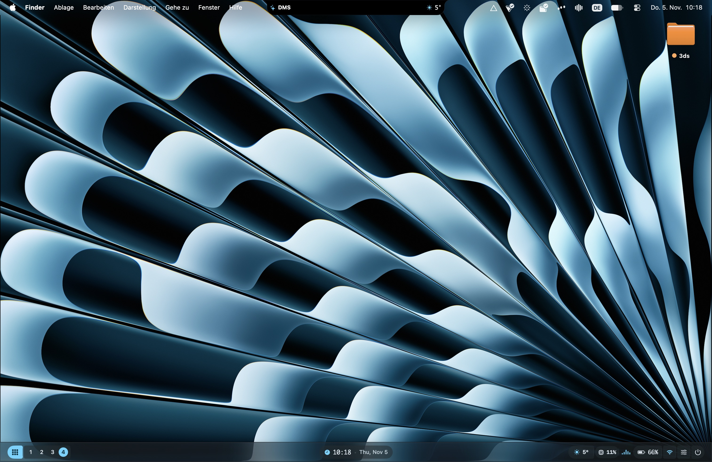

<h1 align="center">DankMacShell</h1>

<p align="center">
  <em>A Material 3 shell for macOS — the tiling window-manager adjacent shell experience, natively on your Mac.</em>
</p>

<p align="center">
  <a href="https://github.com/JonasNowak/DankMacShell/actions/workflows/build.yml"></a>
  <a href="https://github.com/JonasNowak/DankMacShell/releases"></a>
  <a href="https://github.com/JonasNowak/DankMacShell/blob/main/LICENSE"></a>
  
  
  
</p>

<p align="center">
  
</p>

---

## 📑 Contents

- [What is DankMacShell?](#what-is-dankmacshell)
- [Features](#features)
- [Quick Start](#quick-start)
- [Global Hotkeys](#global-hotkeys)
- [DMS CLI (`dms`)](#dms-cli)
- [Configuration](#configuration)
- [URL Scheme (`dms://`)](#url-scheme)
- [License](#license)

<a id="what-is-dankmacshell"></a>

## ✨ What is DankMacShell?

This is built as an adaptation of [DankMaterialShell](https://github.com/AvengeMedia/DankMaterialShell) for macOS. This project has not been endorsed nor is it related to DankMaterialShell or AvengeMedia.

DankMacShell is an additional shell for macOS with [OmniWM](https://github.com/OmniNull/OmniWM). It adds the features that make macOS feel more akin to the typical WM experience on Linux systems.

> [!WARNING]
> Everything in this repository will change, some LLM-written parts will be stripped out. There are major bugs.

<a id="features"></a>

## 🧩 Features

At a glance:

| Component | Hotkey | TL;DR |
| --- | --- | --- |
| DankBar | — | Material 3 status bar & dock |
| DLauncherV2 | `⌥Space` | Spotlight-style app launcher |
| DankDash | `⌥D` | Dashboard: weather, calendar, media, wellbeing |
| Control Center | — | Quick toggles, sliders & theme switcher |
| Wallpaper Browser | — | Set wallpapers & sync OmniWM borders |
| Notepad | `⌥N` | Multi-note scratchpad |
| Clipboard History | `⌥V` | Searchable clipboard store |
| ProcessList | — | Activity-monitor-style task manager |
| ColorPicker | — | Screen eyedropper |
| QR Generator | — | QR codes from any text or URL |
| Keybinds Cheatsheet | — | Every shortcut in one dialog |
| Settings | — | Multi-tab configuration window |
| Dynamic Theming | — | Material You palettes from your wallpaper |

### 📊 1. DankBar (Top/Bottom Status Bar & Dock)
- **Material 3 Design:** Rounded pill chips, dynamic tonal elevation surfaces, and fluid spring animations.
- **Top or Bottom Docking:** Position as a top status bar or bottom floating dock with instant hot-repositioning.
- **Launcher Pill Button:** Direct trigger for the Material 3 Spotlight-style launcher.
- **Spaces / Desktops Pill:** Fast desktop spaces switcher with active workspace indication (OmniWM virtual workspace integration via `omniwmctl subscribe` & Darwin kernel detection).
- **Active App Indicator:** Live display of the currently focused application name and icon.
- **Apps Dock / Taskbar:** Pinned and running applications with live indicator dots, click-to-activate, and context menus (Pin/Unpin, Hide, Quit).
- **Dynamic Island / Clock & Media Pill:** Real-time clock with date tooltip, expandable now-playing snippet with inline pause/play, native volume/brightness/backlight OSD bezel swallowing with fluid capsule expansion, and live weather pill.
- **Hardware Telemetry:** Real-time CPU usage, RAM usage, and battery indicators with live charge states.
- **Quick Controls:** Direct toggles for Control Center, Power Menu, Microphone mute, and Caffeinate (Idle Inhibit).
- **Smart Auto-Hide & Multi-Monitor Layout:** Automatic edge-avoidance and independent status bar managers across secondary monitors and display notches.

### 🔍 2. DLauncherV2 (Spotlight App Launcher)
- **Multi-Category Tabs:** `All`, `Apps`, `Files`, `Calc`, `Clipboard`, and `Emojis`.
- **Spotlight-Style Search:** Instant fuzzy scoring across `/Applications`, `/System/Applications`, `~/Applications`, and user documents.
- **Integrated Calculator:** Evaluates math expressions (`24 * 60`, `15% of 80`, powers, scientific operations) directly in the search bar.
- **Clipboard & Emoji Search:** Instant clipboard item recall and searchable Unicode emoji catalog with copy-to-clipboard.
- **Web Search Fallbacks:** Configurable default search engines (Google, DuckDuckGo, Bing, GitHub, YouTube).
- **Global Hotkey:** Press `⌥Space` (Option + Space) anywhere to toggle the launcher.

### 📈 3. DankDash (Dashboard Overview)
- **Personalized Header:** Dynamic greeting with username and high-resolution live clock.
- **Interactive Calendar:** Full month view with live day highlight.
- **Live Weather Card:** Open-Meteo REST API integration with SF Symbols, temperature in °C/°F, and weather descriptions.
- **Celestial Engine & Weather v2:** Day progress arc with sunrise/sunset/twilight visualization, dew point calculation, and surface pressure.
- **Digital Wellbeing Tab:** Local screen time tracking synchronized with macOS Screen Time (`ScreenTimeAgent`), active app usage breakdown, daily app quotas, 7-day weekly comparison bar charts, and 92-day retention pruning.
- **Now Playing Media Player:** Full media controls (playback progress bar, elapsed/duration time, play/pause, next/previous) for Apple Music and Spotify.
- **Hardware Telemetry Gauges:** Detailed CPU, RAM, and Battery circular/linear progress gauges.
- **Quick Scratchpad:** Embedded mini-notepad synchronized with the main Notepad store.
- **Global Hotkey:** Press `⌥D` (Option + D) anywhere to toggle DankDash.

### 🎛️ 4. Material 3 Control Center
- **Quick Action Tiles:** Rounded toggle chips for:
  - **Modular Drag-and-Drop Editing:** In-situ arrangement chrome with tile library picker sheet and 50-step undo/redo stack.
  - **Avatar Shape Masking:** Shape cycler (Circle, Rounded Hexagon, Star, Diamond, Shield, Blob).
  - **Dedicated Detail Pages:** Expandable detail pages for Do Not Disturb and Caffeinate (Idle Inhibit presets).
  - Wi-Fi (CoreWLAN status & toggle)
  - Bluetooth (IOBluetooth status & toggle)
  - Dark / Light Mode
  - Inhibit Sleep (IOPMAssertion caffeinate toggle)
  - Microphone Mute
  - Screen Capture (`screencapture -i`)
  - Do Not Disturb (Focus)
  - Night Shift (`CBBlueLightClient` dynamic lookup)
  - macOS System Settings shortcut
- **Material 3 Sliders:**
  - Audio Volume with audio output device selector (CoreAudio)
  - Display Brightness (`DisplayServices` private framework dynamic lookup)
- **Theme Switcher:** Live switching between dynamic wallpaper-extracted theme and stock M3 themes (Purple, Blue, Green, Orange, Red, Yellow, Neutral).

### 🖼️ 5. Desktop Wallpaper Browser & OmniWM Theme Sync
- **Wallpapers Tab:** Integrated wallpaper browser with tag/category filters, thumbnail grid, and instant desktop background setting.
- **OmniWM Window Border Sync:** Real-time synchronization of OmniWM focused and inactive window border gradients matching active Material 3 theme palettes (`dms omniwm ...`).

### 📝 6. Notepad (Scratchpad & Notes Manager)
- **Material 3 Scratchpad Editor:** Autosaving markdown/plain-text editor with word and character counters.
- **Multi-Note Drawer:** Create, switch between, and delete notes.
- **Persistent Storage:** Stored locally in JSON format (`~/Library/Application Support/DMS/notes.json`).
- **Global Hotkey:** Press `⌥N` (Option + N) anywhere to toggle Notepad.

### 📋 7. Clipboard History Manager
- **Clipboard Store:** Real-time NSPasteboard observer maintaining search-indexed history.
- **History Modal:** Search past text clippings, view preview snippets, copy back to pasteboard, or clear history.
- **Persistent Storage:** Stored locally in JSON format (`~/Library/Application Support/DMS/clipboard_history.json`).
- **Global Hotkey:** Press `⌥V` (Option + V) anywhere to toggle Clipboard history.

### ⚙️ 8. ProcessList (Activity Monitor / Task Manager)
- **Process Enumeration:** Real-time listing of running processes with PID, CPU %, RAM usage (MB), and user.
- **Sorting & Filtering:** Sort by CPU % or RAM usage, and filter by process name or PID.
- **Process Termination:** Terminate misbehaving tasks (`kill -15` / `kill -9`) directly from the UI.

### 💧 9. ColorPicker (Screen Eyedropper)
- **Magnifying Eyedropper:** Native `NSColorSampler` for pixel sampling across any display.
- **Color Format Conversion:** Instant conversion to HEX, RGB, and HSL values with click-to-copy chips.
- **Recent Swatches:** History strip of recently sampled colors.

### 📱 10. QR Generator
- **CoreImage CIQRCodeGenerator:** Generates crisp QR codes in real-time from arbitrary text or URLs.
- **Wi-Fi QR Shortcut:** One-click button to format current connected Wi-Fi SSID into standard Wi-Fi QR syntax.
- **Export Options:** Copy QR image directly to clipboard or save as PNG.

### ⌨️ 11. Keybinds Cheatsheet
- Searchable quick-reference dialog listing all DMS shell shortcuts and macOS system keybinds.

### 🎨 12. Material 3 Settings Window
- Multi-tab configuration interface:
  - **Appearance:** Theme selection (Dynamic Wallpaper, Purple, Blue, Green, Orange, Red, Yellow, Neutral), Dark/Light toggle.
  - **Bar & Dock:** Top vs Bottom position, Auto-hide toggle, Transparent bar toggle, Show Dock toggle, Show Telemetry toggle.
  - **Launcher:** Hotkey toggle, Weather units (°C/°F), Default web search engine.
  - **Power & Session:** Display sleep timeout, sleep prevention options.
  - **Diagnostics:** Subsystem connectivity check, configuration reset, hot-reload.
  - **About:** Version info, upstream credits, and quick links.

### 🌈 13. Dynamic Wallpaper Theming (Material You)
- Automatically samples the current desktop wallpaper using `CoreImage`.
- Mathematically generates full Material 3 tonal palettes (Primary, Secondary, Tertiary, Surface, Container, Outline, Error tones) for both Dark and Light modes.
- Updates the shell in real time whenever the wallpaper or display appearance changes.

<a id="quick-start"></a>

## 🚀 Quick Start

### ⬇️ 1. Prebuilt Binary

Download the prebuilt `.dmg` from [Releases](https://github.com/JonasNowak/DankMacShell/releases).

### 🔨 2. Build from Source

#### Requirements
- macOS 14+ (macOS 26+ compatible)
- Apple Command Line Tools or Xcode
- OmniWM with IPC turned on!

#### Build & Run
```bash
./build.sh
# Or using make:
make build
```
This builds both release binaries, packages `~/Applications/DankMacShell.app`, signs it, installs `dms` into `~/.local/bin/dms`, and launches the application.

To build without launching:
```bash
./build.sh --no-launch
# Or:
make build-no-launch
```

#### Run Unit Tests
```bash
./test.sh
# Or:
make test
```

#### Package Distributable DMG
```bash
./scripts/create-dmg.sh [version]
# Or:
make dmg
```
Creates a signed, distributable `.dmg` in `dist/`.

#### Clean Build Artifacts
```bash
./build.sh --clean
# Or:
make clean
```

<a id="global-hotkeys"></a>

## ⌨️ Global Hotkeys

| Action | Hotkey |
| --- | --- |
| Toggle DLauncherV2 (Spotlight launcher) | `⌥Space` |
| Toggle DankDash | `⌥D` |
| Toggle Notepad | `⌥N` |
| Toggle Clipboard History | `⌥V` |

<a id="dms-cli"></a>

## 🖥️ DMS CLI (`dms`)

A dedicated command-line utility is installed to `~/.local/bin/dms` for controlling the shell via Unix domain socket (`~/Library/Application Support/DMS/dms.sock`):

<details>
<summary><b>Full command reference</b></summary>

```bash
# General Management
dms start                        # Start DankMacShell app (alias: run)
dms run                          # Alias for 'dms start'
dms stop                         # Stop running DankMacShell
dms restart                      # Restart DankMacShell
dms status                       # Show running status of DMS daemon and socket
dms doctor                       # Run diagnostics check on permissions and subsystems
dms permission                   # Open Accessibility / Device Control settings to grant event swallowing

# Direct Shortcuts
dms spotlight [toggle|open|close]
dms launcher [toggle|open|close]
dms dash [toggle|open|close]
dms control-center [toggle]
dms powermenu [action]
dms notepad [open|toggle|get|set <text>]
dms clipboard [open|list|clear]
dms processlist [open|list|kill <pid>]
dms colorpicker [pick]
dms qr <text>
dms keybinds [open]
dms settings [open|get|set|dump]
dms wellbeing [status|enable|disable|toggle|sync|open-system]
dms bar [reveal|hide|toggle|status|setposition <top|bottom>]
dms dock [reveal|hide|toggle|status]
dms workspace [status|switch <num>|next|prev]
dms audio [status|setvolume <0-100>|mute|unmute|toggle]
dms mic [status|mute|unmute|toggle]
dms brightness [get|set <0-100>|increment|decrement]
dms inhibit [toggle|status]
dms mpris [status|play|pause|next|prev]
dms theme [get|set <name>|list|toggle-mode]
dms weather [status|refresh|location <city|lat,lon>]
dms wallpaper [get|set <path>|list]
dms omniwm [get|sync|mode <mode>|direction <dir>|toggle]
dms screenshot [region|full|window]
dms toast <info|warn|error> <message>
dms version
```

</details>

<a id="configuration"></a>

## ⚙️ Configuration

Settings are stored at:
`~/Library/Application Support/DMS/config.json`

The configuration file is automatically created with defaults on first launch and hot-reloads immediately upon disk changes:

```json
{
  "theme": "purple",
  "isLightMode": false,
  "barPosition": "bottom",
  "barAutoHide": false,
  "barTransparent": false,
  "showDock": true,
  "showTelemetry": true,
  "launcherHotkey": true,
  "weatherUnits": "celsius",
  "searchProvider": "google",
  "pinnedApps": [
    "com.apple.Terminal",
    "com.apple.Safari",
    "com.apple.finder"
  ]
}
```

<a id="url-scheme"></a>

## 🔗 URL Scheme (`dms://`)

DMS registers the `dms://` URL scheme for system integration:
- `open -g dms://toggleLauncher`
- `open -g dms://dash`
- `open -g dms://toggleControlCenter`
- `open -g dms://powerMenu`
- `open -g dms://notepad`
- `open -g dms://clipboard`
- `open -g dms://processlist`
- `open -g dms://colorpicker`
- `open -g dms://keybinds`
- `open -g dms://settings`
- `open -g "dms://setTheme?name=dynamic"`
- `open -g dms://toggleThemeMode`
- `open -g dms://screenshot`
- `open -g dms://reloadConfig`

<a id="license"></a>

## 📜 License

Released under the [MIT License](LICENSE) © 2026 Jonas Nowak.

---

<p align="center">
  <sub>Made with SwiftUI for macOS · Inspired by <a href="https://github.com/AvengeMedia/DankMaterialShell">DankMaterialShell</a> — not affiliated with AvengeMedia</sub>
</p>
