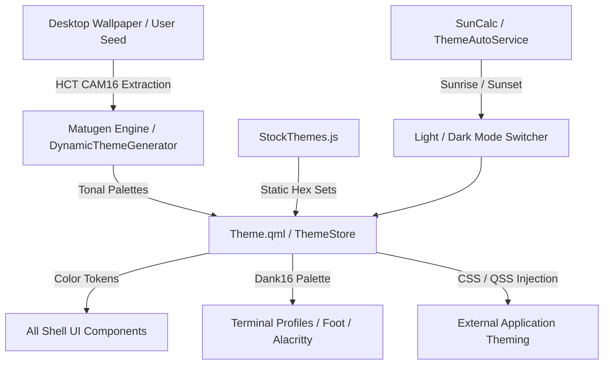

# THEME — Material Design 3 Design Tokens, Color Math, Motion & Shaders Specification

> **Upstream Reference**: Commit `699eb23`  
> **Scope**: M3 Color Tokens, Tonal Palette Generation (HCT), Stock Themes, Matugen Theming, Dank16 Terminal Palette, Typography, Shapes, Elevation & Surface Opacities, Motion Curves, and GLSL Fragment Shaders.

---

## 0. Coverage Manifest

| Upstream Path | Lines | Role |
| :--- | :--- | :--- |
| `quickshell/Common/Theme.qml` | 2,553 | Central Theme singleton, dynamic property bindings, token resolvers |
| `quickshell/Common/StockThemes.js` | 444 | Hardcoded color palettes for Dark/Light stock themes |
| `quickshell/Common/Appearance.qml` | 11 | Global appearance state holder |
| `quickshell/Common/Anims.qml` | 34 | Core animation durations, slide distances, Bezier easing curves |
| `quickshell/Common/AnimVariants.qml` | 50 | Expressive spatial animation variants |
| `quickshell/Common/SpringMotion.qml` | 3 | Physical spring animation controller |
| `quickshell/Common/RectSpringMotion.qml` | 109 | 2D rectangle spring tracking with overshoot damping |
| `quickshell/Common/DankAnim.qml` | 7 | Easing animation wrapper |
| `quickshell/Common/DankColorAnim.qml` | 7 | Color transition animation wrapper |
| `quickshell/Common/ElevationShadow.qml` | 3 | Elevation shadow rendering component |
| `quickshell/Common/FluidGeometry.js` | 42 | Morphing geometry interpolation, overshoot clamping, opacity curves |
| `quickshell/Common/BlurStrength.js` | 40 | Dual Kawase & Gaussian blur reach calculations |
| `quickshell/Common/ThemePalette.js` | 26 | Color palette lookup and indexing helpers |
| `dank-qml-common/DCommon/Common/Tonal.js` | 48 | Tonal container tinting and soft container color mixing |
| `dank-qml-common/DCommon/Common/Hct.js` | 215 | Cam16 and HCT (Hue, Chroma, Tone) mathematical color conversions |
| `dank-qml-common/DCommon/Common/Accents.js` | 32 | Semantic accent color resolvers |
| `dank-qml-common/DCommon/Common/Contrast.js` | 64 | WCAG contrast ratio calculations and linear RGB color mixing |
| `dank-qml-common/DCommon/Common/Surface.js` | 22 | Surface opacity and floating window transparency logic |
| `dank-qml-common/DCommon/Common/Style.qml` | 85 | High-level style constants |
| `dank-qml-common/DCommon/Common/Fonts.qml` | 45 | Font family definitions and loader for bundled TTF fonts |
| `dank-qml-common/DCommon/Common/Shape.js` | 48 | Corner radius definitions (xxs through xxl) and scaling functions |
| `dank-qml-common/DCommon/Shaders/frag/ripple.frag` | 45 | Material Design 3 radial ink ripple fragment shader |
| `dank-qml-common/DCommon/Shaders/frag/wave_progress.frag` | 55 | Sine-wave oscillating progress bar fragment shader |
| `dank-qml-common/DCommon/Shaders/frag/loading_indicator.frag` | 40 | Indeterminate rotating circular loader fragment shader |
| `dank-qml-common/DCommon/Shaders/frag/elevation_rect.frag` | 50 | Box-shadow blur and rounded-rect elevation shader |
| `dank-qml-common/DCommon/Shaders/frag/color_swatch.frag` | 35 | Checkerboard backdrop shader for transparent colors |
| `dank-qml-common/DCommon/Shaders/frag/clock_knockout.frag` | 30 | Circular background mask shader for analog clock hands |
| `quickshell/Services/ThemeAutoService.qml` | 530 | Sunrise/sunset and scheduled automated theme mode switching |
| `quickshell/Services/MatugenPreviewService.qml` | 174 | Real-time preview generation for Matugen color palettes |
| `quickshell/Services/PaletteInjectService.qml` | 139 | Dynamic CSS / GTK / Qt color injection service |
| `quickshell/Services/PortalService.qml` | 372 | XDG Desktop Portal color-scheme synchronization |
| `core/internal/matugen/` | 2,723 | Go-side Matugen wrapper and template processor |
| `core/internal/dank16/` | 880 | Dynamic 16-color ANSI terminal palette generator |
| `core/internal/themes/` | 703 | Theme registry, loading, and persistence logic |

---

## 1. Purpose & User-Visible Behavior

DMS provides a full implementation of Google's **Material Design 3 (Material You)** design system.
1. **Dynamic Tonal Theming**: The shell extracts a dominant seed color from the desktop wallpaper (or accepts a user-defined hex code) and mathematically constructs a set of 5 tonal palettes (Primary, Secondary, Tertiary, Neutral, Neutral Variant) across 13 tone levels (0, 10, 20, 25, 30, 40, 50, 60, 70, 80, 90, 95, 98, 100).
2. **Stock Themes**: Out-of-the-box support for curated stock palettes:
   - Generic: `Blue`, `Purple` (default), `Green`, `Orange`, `Red`, `Yellow`, `Neutral`.
   - Community: `Catppuccin (Mocha/Latte)`, `Nord`, `Gruvbox`, `Tokyo Night`, `Everforest`.
3. **Contrast Modes**: Standard, Medium (+0.3 contrast), and High (+0.6 contrast) compliant with WCAG AAA accessibility.
4. **Elevation Surfaces**: Surfaces do not use arbitrary gray shades; instead, `surfaceContainerLowest` through `surfaceContainerHighest` use tonal surface shifts blended with primary tint.
5. **Dank16 Terminal Palette**: Dynamically calculates an ANSI 16-color palette derived from the active wallpaper tones.
6. **Expressive Motion**: Animation curves strictly implement Material 3 Bezier splines (`emphasized`, `emphasizedDecel`, `emphasizedAccel`, `standard`, `standardDecel`, `standardAccel`) and physical spring models.

---

## 2. Architecture & Data Flow

---

## 3. Detailed Requirements

### 3.1. Corner Radii & Shapes (`Shape.js`)
- `THEME-001`: Corner radii tokens must strictly match the following pixel values:
  - `xxs`: 2px (`Shape.js:4`)
  - `xs`: 4px (`Shape.js:5`)
  - `s`: 8px (`Shape.js:6`)
  - `m`: 12px (`Shape.js:7`)
  - `l`: 16px (`Shape.js:8`)
  - `lIncreased`: 20px (`Shape.js:9`)
  - `xl`: 28px (`Shape.js:10`)
  - `xlIncreased`: 32px (`Shape.js:11`)
  - `xxl`: 48px (`Shape.js:12`)
  - `full`: 9999px (Capsule/Pill)
- `THEME-002`: Corner radius scaling must support a user-defined strength factor (0% to 100%, default 50% = 1.0x scale) via formula: `scale = normalizeStrength(strength) / 50` (`Shape.js:28`). When `fixedRadius >= 0`, fixed radius overrides scaled tokens.

### 3.2. Motion & Animation Curves (`Anims.qml`)
- `THEME-003`: Core animation durations:
  - `durShort`: 200ms (`Anims.qml:11`)
  - `durMed`: 450ms (`Anims.qml:12`)
  - `durLong`: 600ms (`Anims.qml:13`)
  - `settingsNavigationStateDuration`: 180ms (`Anims.qml:16`)
  - `settingsNavigationRippleDuration`: 200ms (`Anims.qml:17`)
  - `slidePx`: 80px translation distance for slide-ins (`Anims.qml:19`)
- `THEME-004`: Material 3 Cubic Bezier Easing Splines:
  - `emphasized`: `[0.05, 0.0, 0.133333, 0.06, 0.166667, 0.4, 0.208333, 0.82, 0.25, 1.0, 1.0, 1.0]` (`Anims.qml:21`)
  - `emphasizedDecel`: `[0.05, 0.7, 0.1, 1.0, 1.0, 1.0]` (`Anims.qml:23`)
  - `emphasizedAccel`: `[0.3, 0.0, 0.8, 0.15, 1.0, 1.0]` (`Anims.qml:25`)
  - `standard`: `[0.2, 0.0, 0.0, 1.0, 1.0, 1.0]` (`Anims.qml:27`)
  - `standardDecel`: `[0.0, 0.0, 0.0, 1.0, 1.0, 1.0]` (`Anims.qml:28`)
  - `standardAccel`: `[0.3, 0.0, 1.0, 1.0, 1.0, 1.0]` (`Anims.qml:29`)

### 3.3. Color Tokens & Surface Math (`Theme.qml`, `Tonal.js`)
- `THEME-005`: All color tokens must be provided for both Dark and Light modes:
  - `primary`, `onPrimary`, `primaryContainer`, `onPrimaryContainer`, `inversePrimary`
  - `secondary`, `onSecondary`, `secondaryContainer`, `onSecondaryContainer`
  - `tertiary`, `onTertiary`, `tertiaryContainer`, `onTertiaryContainer`
  - `surface`, `onSurface`, `surfaceVariant`, `onSurfaceVariant`, `surfaceTint`
  - `surfaceContainerLowest`, `surfaceContainerLow`, `surfaceContainer`, `surfaceContainerHigh`, `surfaceContainerHighest`
  - `background`, `onBackground`
  - `outline`, `outlineVariant`, `scrim`, `shadow`
  - `error`, `onError`, `errorContainer`, `onErrorContainer`
  - Semantic accents: `info`, `success`, `warning` with matching `on*` and `*Container` variants.
- `THEME-006`: Soft container mixing (`Tonal.js:19-26`): `softContainer(accent, card, tint)` must calculate:
  `tone = cardTone < 50 ? max(30, cardTone + 16) : min(90, cardTone - 4)`. Base is card hue/chroma at tone; full is accent hue with chroma clamped to 48 at tone; output is linear RGB mix by tint factor.

### 3.4. Typography Stack (`Fonts.qml`)
- `THEME-007`: The typography hierarchy must resolve to:
  - Body & UI Sans: `Google Sans Flex` (bundled weights 100 through 900)
  - Monospace: `Fira Code` / `FiraCode Nerd Font`
  - Display / Hero: `DM Serif Display`
  - Stylistic Hand: `Gochi Hand`
  - Stylistic Display: `Notable`
  - Iconography: `Material Symbols Rounded` (variable font with axes `FILL`, `GRAD`, `opsz`, `wght`)

### 3.5. Fragment Shaders
- `THEME-008`: Custom rendering effects must faithfully replicate:
  - `ripple.frag`: Smooth circular expansion with fading edge alpha.
  - `wave_progress.frag`: Continuous sine-wave oscillation along the progress bar leading edge.
  - `loading_indicator.frag`: Anti-aliased rotating arc with variable stroke width.
  - `elevation_rect.frag`: Procedural box-shadow with corner-radius clipping and Gaussian blur falloff.

---

## 4. Settings Keys

| Key | Type | Default | Effect | UI Location |
| :--- | :--- | :--- | :--- | :--- |
| `theme` | string | `"purple"` | Active theme name or `"dynamic"` | Appearance Tab |
| `isLightMode` | bool | `false` | Global light vs dark appearance | Control Center / Appearance |
| `matugenScheme` | string | `"scheme-tonal-spot"` | Algorithm for tonal palette generation | Theme Colors Tab |
| `matugenContrast` | double | `0.0` | Contrast adjustment factor (-1.0 to 1.0) | Theme Colors Tab |
| `matugenSourceMode`| string | `"dominant"` | Wallpaper sampling strategy (`"dominant"`, `"vibrant"`) | Theme Colors Tab |
| `cornerRadiusStrength`| int | `50` | Global corner radius scaling (0 to 100) | Typography & Motion Tab |
| `animationSpeed` | double | `1.0` | Global multiplier for animation durations | Typography & Motion Tab |

---

## 5. IPC / CLI / Socket API

| Target / Command | Arguments | Return / Side Effect |
| :--- | :--- | :--- |
| `dms theme get` | none | Returns `{ "theme": "purple", "isLightMode": false }` |
| `dms theme set <name>` | `<name>` | Changes active theme and regenerates tokens |
| `dms theme toggle-mode`| none | Toggles between Dark and Light mode |
| `dms matugen regen` | none | Re-samples current wallpaper and regenerates M3 colors |

---

## 6. Wayland/Linux Mechanisms → macOS Mapping

1. **Matugen CLI Linux Binary**:
   - Upstream executes the external `matugen` Rust/Go binary to generate themes.
   - **macOS Approach**: Implement pure native Swift HCT color math (`Cam16`, `Hct`, `TonalPalette`) inside `DMSCore/DynamicThemeGenerator.swift`, removing external process dependencies.
2. **XDG Desktop Portal Theme Synchronization**:
   - Upstream listens to D-Bus `org.freedesktop.portal.Settings`.
   - **macOS Approach**: Observe `NSApplication.effectiveAppearanceCustomizationNotification` and `DistributedNotificationCenter.default().addObserver(forName: "AppleInterfaceThemeChangedNotification")`.
3. **Application Theming (GTK / Qt / Foot)**:
   - Upstream injects generated CSS files into `~/.config/gtk-3.0/gtk.css`, etc.
   - **macOS Approach**: Generate macOS Terminal and iTerm2 color presets into `~/Library/Application Support/DMS/palettes/`, and expose a script/hook for user terminal configurations.

---

## 7. Port Audit (Current macOS Port vs. Upstream)

| Requirement ID | Status | Port File(s) | Audit Findings / Deficiencies |
| :--- | :--- | :--- | :--- |
| `THEME-001` - `002` | **Missing** | None | Port uses hardcoded corner radii (e.g. `cornerRadius(16)`) in SwiftUI views; no `Shape.js` token system or scaling exists. |
| `THEME-003` - `004` | **Missing** | None | Port uses standard SwiftUI `.animation(.easeInOut)` without Material 3 Bezier curves or spring parameters. |
| `THEME-005` | **Partial** | `ThemePalette.swift` | Implements basic M3 colors for 10 themes, but lacks tonal container variations, surfaceContainerLowest, and semantic accents. |
| `THEME-006` | **Missing** | None | Soft container mixing and HCT color math are completely missing. |
| `THEME-007` | **Divergent** | Views | Port relies on Apple system fonts (`San Francisco`) and SF Symbols instead of `Google Sans Flex` and `Material Symbols Rounded`. |
| `THEME-008` | **Missing** | None | Shaders (ripple, wave progress, elevation rect) are absent; basic SwiftUI progress bars are used. |

### Audit Verdict:
The current port provides a basic dictionary of M3 color hex codes, but **completely lacks the M3 tokenized architecture**. Font tokens, shape tokens, M3 cubic Bezier curves, HCT color conversions, and custom rendering shaders are missing. Estimated parity: **~20%**.

---

## 8. Reimplementation Checklist

- [ ] Port `Hct.js` and `Tonal.js` into native Swift 6 in `DMSCore` (full Cam16 color space math).
- [ ] Create `ThemeTokens.swift` implementing all corner radii (`xxs` through `xxl`), durations (`durShort`, `durMed`, `durLong`), and Bezier curves.
- [ ] Bundle `MaterialSymbolsRounded.ttf` and `GoogleSansFlex.ttf` in application bundle resources.
- [ ] Implement Metal / SwiftUI custom shader modifiers for ripple effects and wave progress bars.
- [ ] Implement `Dank16` ANSI generator for terminal exports.
