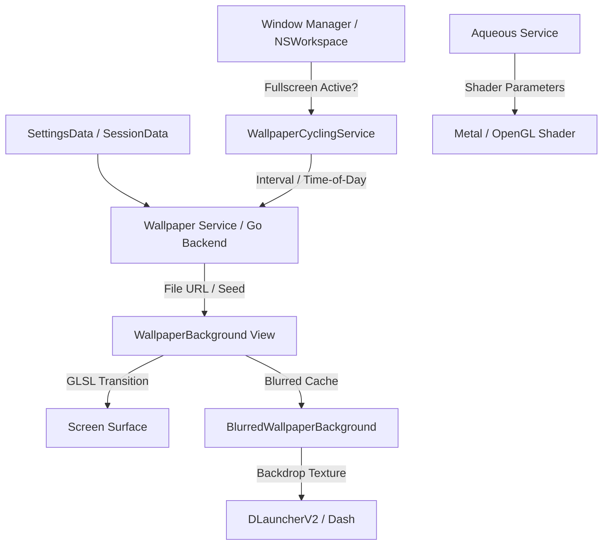

# WALL — Wallpaper Rendering, Transitions, Blur & Aqueous Specification

> **Upstream Reference**: Commit `699eb23`  
> **Scope**: Wallpaper Rendering (`WallpaperBackground.qml`), Transition Shaders, Fill Modes, Per-Monitor Configurations, Blurred Backgrounds (`BlurredWallpaperBackground.qml`, `BlurredWallpaperLive.qml`), Wallpaper Cycling (`WallpaperCyclingService.qml`), and Aqueous Shader Engine (`AqueousService.qml`, `AqueousConfigService.qml`, `AqueousIpc.js`).

---

## 0. Coverage Manifest

| Upstream Path | Lines | Role |
| :--- | :--- | :--- |
| `quickshell/Modules/WallpaperBackground.qml` | 1,446 | Desktop wallpaper background window, layer-shell surface, transition shaders |
| `quickshell/Modules/BlurredWallpaperBackground.qml` | 320 | Pre-blurred static wallpaper cache for app launcher and overview backdrops |
| `quickshell/Modules/BlurredWallpaperLive.qml` | 195 | Live real-time compositor wallpaper blur surface |
| `quickshell/Services/WallpaperCyclingService.qml` | 527 | Automated wallpaper cycling scheduler, fullscreen pause logic |
| `quickshell/Services/MediaAccentService.qml` | 209 | Dynamic wallpaper/media accent extraction and blending |
| `quickshell/Services/AqueousService.qml` | 971 | Aqueous live animated shader wallpaper service |
| `quickshell/Services/AqueousConfigService.qml` | 171 | Aqueous shader parameter configuration and persistence |
| `quickshell/Common/AqueousIpc.js` | 107 | IPC commands for Aqueous runtime controls |
| `quickshell/Widgets/MaterialWallpaper.qml` | 7 | Procedural Material You wallpaper generator widget |
| `dank-qml-common/DCommon/Common/MaterialWallpaper.js` | 95 | Mathematical generation of geometric Material 3 wallpapers |
| `core/internal/server/wallpaper/` | 526 | Go backend for directory scanning, image cache, and cycle sequences |

---

## 1. Purpose & User-Visible Behavior

DMS provides a multi-monitor wallpaper system:
1. **Multi-Monitor Assignment**: Independent wallpapers per connected display or synchronized mirroring.
2. **Transition Effects**: Rich GPU transitions between wallpaper changes:
   - `fade`: Smooth cross-fade.
   - `wipe`: Linear edge wipe with adjustable angle (`wipeDirection`).
   - `disc`: Expanding circular iris wipe from center (`discCenterX`, `discCenterY`).
   - `stripes`: Alternating venetian blind wipe (`stripesCount: 16`, `stripesAngle: 0`).
   - `random`: Random selection from user-enabled transition types.
3. **Fill Modes**: `crop` (fill screen, preserve aspect), `fit` (letterbox/pillarbox with M3 surface background), `stretch` (distort to fill), `tile` (repeat pattern), `center` (1:1 pixel center).
4. **Desktop Context Menu**: Right-clicking the empty wallpaper opens the shell context menu (`PopoutService.desktopContextMenu`).
5. **Automated Cycling**: Automatically rotates through a folder of images on a set interval (minutes) or specific time of day. Automatically pauses if a fullscreen window is active.
6. **Aqueous Live Shaders**: High-performance procedural live wallpapers (fluid simulation, gradient waves, particle fields) with real-time parameter tweaking.

---

## 2. Architecture & Data Flow

---

## 3. Detailed Requirements

### 3.1. Wallpaper Rendering & Geometry (`WallpaperBackground.qml`)
- `WALL-001`: Each screen must have an independent background window mapped behind all desktop icons and windows (`WallpaperBackground.qml:25-35`).
- `WALL-002`: Right-click on the wallpaper must trigger the Desktop Context Menu with coordinates (`WallpaperBackground.qml:48-52`).
- `WALL-003`: Fill mode rendering must faithfully respect:
  - `crop`: `PreserveAspectCrop`
  - `fit`: `PreserveAspectFit` with letterbox bars filled with `fillColor` (derived from M3 `surfaceContainerLowest`).
  - `stretch`: Stretch to fill window bounds.
  - `tile`: Repeat texture across horizontal and vertical axes.
  - `center`: Unscaled 1:1 image placed at screen midpoint.

### 3.2. Transition Shader Engine (`WallpaperBackground.qml:162-235`)
- `WALL-004`: Transition duration must default to 600ms (`Theme.durLong`), parameterized by `transitionProgress` (0.0 to 1.0).
- `WALL-005`: Transitions supported:
  - `fade`: Linear alpha crossfade.
  - `wipe`: Step transition along direction angle with `edgeSmoothness: 0.1`.
  - `disc`: Radial distance comparison against `transitionProgress * maxRadius`.
  - `stripes`: Modular arithmetic on screen coordinates dividing into 16 stripes.
- `WALL-006`: When a transition begins, the current frame must be frozen into an offscreen texture buffer while the new image loads asynchronously. Once loaded, the transition shader executes, then releases the outgoing image to minimize memory footprint.

### 3.3. Cycling Scheduler (`WallpaperCyclingService.qml`)
- `WALL-007`: Scheduling modes:
  - `interval`: Timer firing every $N$ minutes (configurable, default 15 mins).
  - `timeOfDay`: Firing at designated wall-clock timestamps (e.g. 08:00, 18:00).
- `WALL-008`: Cycling pause condition: If any application on the target display is fullscreen and active, or if the user session is locked, cycling must pause and resume only when the fullscreen window exits or session unlocks (`WallpaperCyclingService.qml:17-25`).

### 3.4. Aqueous Live Wallpaper Engine (`AqueousService.qml`)
- `WALL-009`: When Aqueous is enabled, procedural fragment shaders replace static image textures.
- `WALL-010`: Real-time parameters exposed via IPC: speed, palette injection, wave complexity, mouse reaction.

---

## 4. Settings Keys

| Key | Type | Default | Effect | UI Location |
| :--- | :--- | :--- | :--- | :--- |
| `wallpaperPath` | string | `""` | Primary wallpaper file path | Wallpaper Tab |
| `wallpaperTransition` | string | `"fade"` | Transition effect name | Wallpaper Tab |
| `wallpaperTransitionDuration` | int | `600` | Duration of transition in ms | Wallpaper Tab |
| `wallpaperFillMode` | string | `"crop"` | Fill mode enum | Wallpaper Tab |
| `wallpaperCyclingEnabled` | bool | `false` | Enable automated rotation | Wallpaper Cycling Tab |
| `wallpaperCyclingInterval` | int | `15` | Minutes between rotations | Wallpaper Cycling Tab |
| `aqueousEnabled` | bool | `false` | Enable live procedural shaders | Wallpaper Tab |

---

## 5. IPC / CLI / Socket API

| Target / Command | Arguments | Return / Side Effect |
| :--- | :--- | :--- |
| `dms wallpaper get` | `[monitor]` | Returns current wallpaper path and fill mode |
| `dms wallpaper set <path>`| `<path> [monitor]` | Sets wallpaper for screen and triggers transition |
| `dms wallpaper cycle` | none | Forces immediate cycle to next image in directory |
| `dms wallpaper aqueous <on\|off>`| `<bool>` | Enables or disables Aqueous shader engine |

---

## 6. Wayland/Linux Mechanisms → macOS Mapping

1. **Layer-Shell `WlrLayer.Background`**:
   - Upstream uses `zwlr_layer_shell_v1` with `WlrLayer.Background` and `ExclusionMode.Ignore`.
   - **macOS Approach**: Create an `NSPanel` per display with `level = NSWindow.Level(Int(CGWindowLevelForKey(.desktopWindow)))` (below desktop icons) or right above desktop (`kCGDesktopWindowLevel + 1`). Set `collectionBehavior = [.canJoinAllSpaces, .stationary, .ignoresCycle]`.
2. **Right-Click Desktop Interception**:
   - macOS desktop is owned by Finder.
   - **macOS Approach**: When DMS desktop management is enabled, the background `NSPanel` handles `rightMouseDown(with:)` and pops up `DesktopContextMenu`. If disabled, window is transparent and clicks pass through to Finder.
3. **Fullscreen Window Detection**:
   - Upstream checks `ToplevelManager.toplevels` for `fullscreen && activated`.
   - **macOS Approach**: Observe `NSWorkspace.activeSpaceDidChangeNotification` and inspect window geometry via `CGWindowListCopyWindowInfo([.optionOnScreenOnly, .excludeDesktopElements], kCGNullWindowID)` comparing window bounds to screen frame.

---

## 7. Port Audit (Current macOS Port vs. Upstream)

| Requirement ID | Status | Port File(s) | Audit Findings / Deficiencies |
| :--- | :--- | :--- | :--- |
| `WALL-001` | **Missing** | None | Port does not render desktop wallpapers; it relies 100% on macOS Finder to render wallpapers. |
| `WALL-002` | **Missing** | None | Desktop context menu on right click does not exist. |
| `WALL-003` - `006` | **Missing** | None | Transition shader engine (wipe, disc, stripes, crossfade) does not exist. |
| `WALL-007` - `008` | **Missing** | None | Wallpaper cycling service does not exist in port. |
| `WALL-009` - `010` | **Missing** | None | Aqueous live wallpaper engine does not exist in port. |

### Audit Verdict:
The port currently implements **0% of the DMS Wallpaper engine**. It only reads `NSWorkspace.shared.desktopImageURL` to extract colors for `DynamicThemeGenerator`, but has no background windowing, no transitions, no cycling, and no live shader support. Parity: **0%**.

---

## 8. Reimplementation Checklist

- [ ] Create `WallpaperWindowController` hosting an `NSPanel` pinned at desktop level for each `NSScreen`.
- [ ] Implement Metal-backed transition shader pipeline (`Fade`, `Wipe`, `Disc`, `Stripes`).
- [ ] Implement `WallpaperCyclingService` with timer and fullscreen detection.
- [ ] Implement Desktop Context Menu trigger on secondary click.
- [ ] Port `Aqueous` procedural shaders to Apple Metal (`.metal`).
