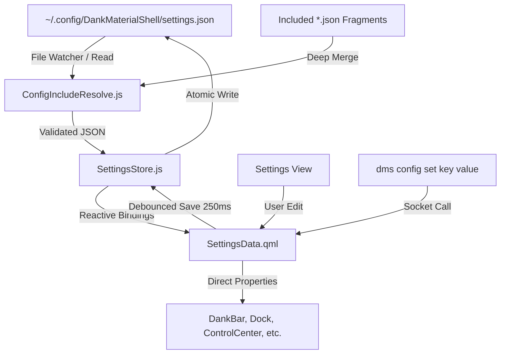

# SETD — Settings Data Architecture, Schemas, & Multi-Instance Configuration Specification

> **Upstream Reference**: Commit `699eb23`  
> **Scope**: Complete configuration schema (`SettingsSpec.js`, 427 keys), `SettingsData.qml`, Multi-Bar Schema, Multi-Dock Schema (`DockConfig.js`), Bar Widget Option Schemas (`BarWidgetDefaults.js`), Configuration Fragments/Includes (`ConfigIncludeResolve.js`), Persistence Format, Migration Strategy, and Hot-Reloading.

---

## 0. Coverage Manifest

| Upstream Path | Lines | Role |
| :--- | :--- | :--- |
| `quickshell/Common/SettingsData.qml` | 4,102 | Central reactive settings store, property bindings, screen helpers |
| `quickshell/Common/settings/SettingsSpec.js` | 1,685 | Master specification dictionary of all 427 settings keys, defaults, coercions |
| `quickshell/Common/settings/SettingsStore.js` | 995 | Low-level JSON serializer, atomic disk persistence, deep-cloning |
| `quickshell/Common/settings/DockConfig.js` | 417 | Dock instance schema factory, magnification profiles, edge validation |
| `quickshell/Common/settings/BarWidgetDefaults.js` | 306 | Per-widget configuration defaults, island routing, control center ordering |
| `quickshell/Common/ConfigIncludeResolve.js` | 176 | External config fragment inclusion (`$include`) and deep-merging |
| `quickshell/Common/SettingsTabs.qml` | 873 | Settings categories tree, navigation hierarchy definitions |
| `quickshell/Common/SettingsUiState.qml` | 39 | Transient UI state for the settings window |
| `core/internal/config/` | 1,559 | Go backend config validator, schema migrator, CLI config getter/setter |
| `core/internal/configfrag/` | 134 | Go config file fragment reader |
| `core/cmd/dms/commands_config.go` | 420 | `dms config get`, `dms config set`, `dms config dump` CLI commands |

---

## 1. Purpose & User-Visible Behavior

The DMS Settings system is the single source of truth for all shell customization.
1. **Multi-Instance Bar Architecture**: Supports zero, one, or multiple bars per display, positioned on any edge (top, bottom, left, right), with individual widget layouts, segment roles, and auto-hide behaviors.
2. **Multi-Instance Dock Architecture**: Supports multiple independent docks per screen or across displays, with customizable magnification curves, app grouping, and trash controls.
3. **Hot-Reloading**: Any change to `settings.json` on disk is immediately detected via file system watchers, validated, and applied without restarting the shell.
4. **Config Fragments (`$include`)**: Power users can modularize their config across multiple files (e.g. `~/.config/dms/bars.json`, `~/.config/dms/theme.json`).
5. **Atomic Writing**: Saves are written to a temporary file (`settings.json.tmp`) and atomically renamed to prevent corruption.

---

## 2. Architecture & Data Flow



---

## 3. Detailed Requirements

### 3.1. File Locations & Formats
- `SETD-001`: Settings must be stored in `~/Library/Application Support/DMS/settings.json` (or `~/.config/DankMaterialShell/settings.json`).
- `SETD-002`: All disk writes must debounce by 250ms and write atomically (`tmpFile` -> `rename`).
- `SETD-003`: When `$include` arrays exist in the root JSON, paths must be resolved relative to the main config directory and deep-merged with root precedence (`ConfigIncludeResolve.js:45-80`).

### 3.2. Bar Instance Configuration Schema (`BarConfig`)
- `SETD-004`: `barConfigs` is an array of objects matching the schema:
  - `id`: Unique string ID (e.g. `"primary-bar"`).
  - `name`: Display name.
  - `screenPreferences`: Array of strings (`["all"]` or monitor names e.g. `["eDP-1"]`).
  - `position`: Enum `top`, `bottom`, `left`, `right`.
  - `autoHide`: Boolean.
  - `smartAutoHide`: Boolean (hides only when windows overlap bar area).
  - `thickness`: Integer px (default 48 for horizontal, 54 for vertical).
  - `margin`: Integer px.
  - `spacing`: Integer px.
  - `transparency`: Float 0.0 to 1.0.
  - `gothCorners`: Boolean (renders concave corner bridges).
  - `layout`: Object containing 3 widget lists: `{ left: [...], center: [...], right: [...] }`.
  - Each widget entry: `{ id: string, enabled: bool, options: object }`.

### 3.3. Dock Instance Configuration Schema (`DockConfig.js`)
- `SETD-005`: `dockConfigs` is an array of objects matching:
  - `id`: String ID (`"dock"`).
  - `name`: String (`"Dock"`).
  - `enabled`: Boolean.
  - `screenPreferences`: `["all"]`.
  - `position`: 0=top, 1=bottom, 2=left, 3=right.
  - `iconSize`: Integer px (default 42).
  - `spacing`: Integer px (default 8).
  - `margin`: Integer px (default 8).
  - `bottomGap`: Integer px (default 0).
  - `autoHide`: Boolean (default false).
  - `smartAutoHide`: Boolean (default false).
  - `groupByApp`: Boolean (default false).
  - `separatePinnedAndRunningApps`: Boolean (default false).
  - `indicatorStyle`: Enum `"circle"`, `"line"`, `"pill"`, `"dot"`.
  - `magnification`: Boolean (default false).
  - `magnificationScale`: Integer percent (default 130, range 100-250).
  - `magnificationProfile`: Enum `"parabolic"`, `"cosine"`, `"gaussian"`.
  - `showTrash`: Boolean (default false).

### 3.4. Master Settings Keys Specification (Summary of 427 Keys)
- `SETD-006`: The complete specification contains 427 keys classified into subsystems:
  1. **Theme & Palette (45 keys)**: `theme`, `isLightMode`, `matugenScheme`, `matugenContrast`, `matugenSourceMode`, `matugenSeedColor`, `popupTransparency`, `floatingWindowTransparency`, etc.
  2. **DankBar Core (65 keys)**: `barConfigs`, `barExclusiveZone`, `barBorderEnabled`, `barBorderColor`, `barHoverOpenDelay`, etc.
  3. **Dock (38 keys)**: `dockConfigs`, `dockMagnification`, `dockIconSize`, `dockIndicatorStyle`, etc.
  4. **Control Center (32 keys)**: `controlCenterWidgets`, `controlCenterGroupOrder`, `controlCenterWidth`, etc.
  5. **DLauncherV2 (42 keys)**: `launcherMode`, `launcherFrecencyWeight`, `launcherFuzzyFidelity`, `launcherTileColumns`, `launcherShowCalculator`, `launcherShowFiles`, etc.
  6. **Dynamic Island (48 keys)**: All `ISLAND_DEFAULTS` keys (see `BarWidgetDefaults.js:10-50`).
  7. **Notifications (28 keys)**: `notificationPopupLocation`, `notificationTimeoutLow`, `notificationTimeoutNormal`, `notificationTimeoutCritical`, `notificationRules`, etc.
  8. **Audio & Media (24 keys)**: `maxVolumePercent`, `volumeStep`, `soundEffectsEnabled`, `lyricsProvider`, etc.
  9. **Power & Display (35 keys)**: `idleDimTimeout`, `idleLockTimeout`, `idleDpmsTimeout`, `nightShiftSchedule`, `nightShiftTemperature`, etc.
  10. **Compositor & Window Rules (40 keys)**: `windowRules`, `workspaceNaming`, `overviewLayout`, etc.
  11. **Utilities & Plugins (26 keys)**: `clipboardMaxItems`, `clipboardMaskPasswords`, `notepadAutosaveDelay`, `pluginRegistries`, etc.

---

## 4. Settings Persistence Schema

```json
{
  "$schema": "https://danklinux.com/schemas/dms-settings.v2.json",
  "version": 2,
  "theme": "purple",
  "isLightMode": false,
  "barConfigs": [
    {
      "id": "main-bar",
      "position": "bottom",
      "thickness": 48,
      "autoHide": false,
      "layout": {
        "left": [{ "id": "launcherButton", "enabled": true }, { "id": "workspaceSwitcher", "enabled": true }],
        "center": [{ "id": "clock", "enabled": true, "options": { "showDate": true } }],
        "right": [{ "id": "media", "enabled": true }, { "id": "battery", "enabled": true }, { "id": "controlCenterButton", "enabled": true }]
      }
    }
  ],
  "dockConfigs": [
    {
      "id": "main-dock",
      "enabled": true,
      "position": 1,
      "iconSize": 42,
      "magnification": true,
      "magnificationScale": 130
    }
  ]
}
```

---

## 5. IPC / CLI / Socket API

| Command | Arguments | Return / Side Effect |
| :--- | :--- | :--- |
| `dms settings get <key>` | `<key>` | Returns JSON value of requested setting |
| `dms settings set <key> <val>` | `<key> <val>` | Coerces type, validates against schema, writes to store |
| `dms settings dump` | none | Returns complete serialized settings JSON |
| `dms settings reload` | none | Re-reads configuration file from disk |

---

## 6. Wayland/Linux Mechanisms → macOS Mapping

1. **XDG Base Directory**:
   - Upstream uses `~/.config/DankMaterialShell/settings.json`.
   - **macOS Approach**: Read primary from `~/Library/Application Support/DMS/settings.json`, with a fallback symlink check to `~/.config/DankMaterialShell/settings.json` for cross-platform dotfile synchronization.
2. **File System Watching**:
   - Upstream uses Quickshell `FileSystemWatcher`.
   - **macOS Approach**: Use `DispatchSource.makeFileSystemObjectSource` with `.write` and `.rename` flags on the configuration directory file descriptor.

---

## 7. Port Audit (Current macOS Port vs. Upstream)

| Requirement ID | Status | Port File(s) | Audit Findings / Deficiencies |
| :--- | :--- | :--- | :--- |
| `SETD-001` - `003` | **Partial** | `ConfigStore.swift` | Implements basic JSON reading and saving, but lacks `$include` fragment merging and schema validation. |
| `SETD-004` | **Missing** | `Config.swift` | `DMSConfig` has no `barConfigs` array; it only has scalar properties (`barPosition`, `barAutoHide`, `barTransparent`). It cannot support multiple bars or per-bar widget options. |
| `SETD-005` | **Missing** | `Config.swift` | `DMSConfig` has no `dockConfigs` array; it only has `showDock: Bool`. Magnification curves, profiles, and per-dock positions are missing. |
| `SETD-006` | **Divergent** | `Config.swift` | Out of 427 upstream keys, only 35 exist (~8.2% coverage). The remaining 392 keys have no representation in Swift models. |

### Audit Verdict:
The port currently implements a **flat, primitive 35-property struct** rather than DMS's hierarchical multi-instance configuration model. Without `barConfigs` and `dockConfigs` arrays, users cannot create per-monitor bars, multiple bars, or customize widget placements. Parity: **~8%**.

---

## 8. Reimplementation Checklist

- [ ] Rewrite `DMSCore/Config.swift` to declare the full 427-key hierarchy with `BarConfig`, `DockConfig`, and `WidgetConfig` sub-models.
- [ ] Implement `ConfigIncludeResolver.swift` supporting `$include` array merging.
- [ ] Add JSON Schema validation and migration versioning.
- [ ] Implement file watcher debounced at 250ms with atomic write semantics.
- [ ] Wire up `dms settings get/set/dump` in `DMSCLI`.
