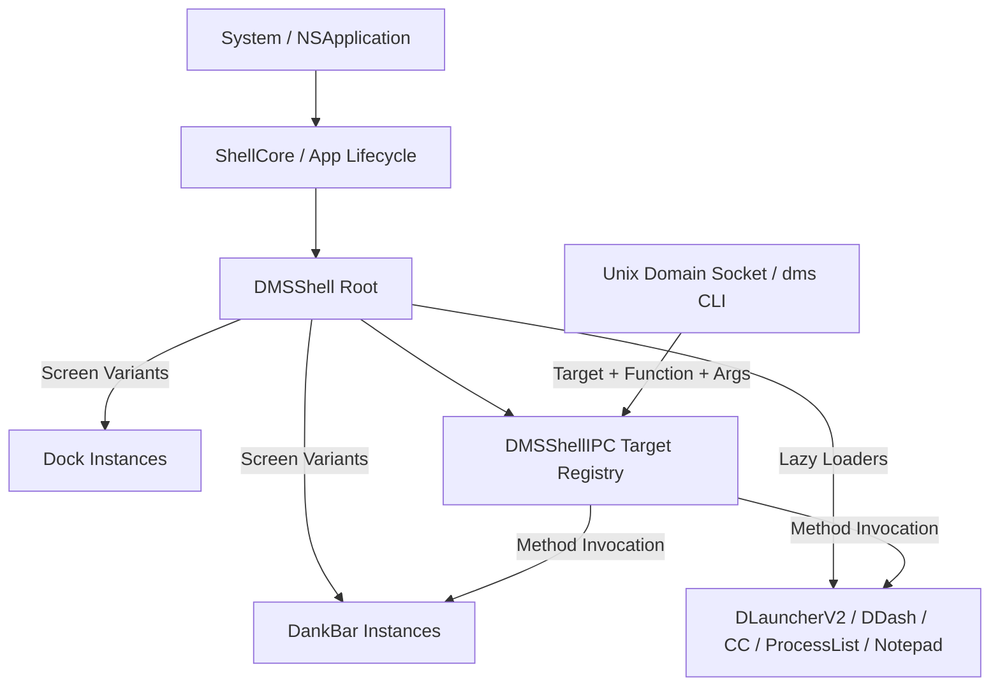

# SHELL — Shell Root Composition, Lifecycle & Master IPC Target Index Specification

> **Upstream Reference**: Commit `699eb23`  
> **Scope**: Shell Root Composition (`shell.qml`, `DMSShell.qml`, `ShellCore.qml`), Multi-Monitor Instantiation (`Variants`), Lazy Component Loading, Startup Sequence, Surface Recovery, In-Shell Toasts (`Toast.qml`), Modal Chrome Architecture (`Modals/Common/*`), and the Master IPC Target Index (`DMSShellIPC.qml`).

---

## 0. Coverage Manifest

| Upstream Path | Lines | Role |
| :--- | :--- | :--- |
| `quickshell/shell.qml` | 85 | Shell entrypoint, environment validation, core initialization |
| `quickshell/DMSShell.qml` | 1,388 | Master shell root: surface declarations, multi-screen variants, global timers |
| `quickshell/DMSShellIPC.qml` | 2,230 | Central IPC router containing 33 IPC handler targets and 90+ functions |
| `quickshell/ShellCore.qml` | 145 | Core surface recovery coordinator and layout revision sequencer |
| `quickshell/DMSGreeter.qml` | 120 | Standalone greeter mode root configuration |
| `quickshell/VERSION` | 1 | Semantic release version string |
| `quickshell/CODENAME` | 1 | Release codename string |
| `quickshell/Modules/Toast.qml` | 420 | Toast notification surface, queue management, progress indicator |
| `quickshell/Services/DMSService.qml` | 826 | Core Go backend socket connection and capabilities handshake |
| `quickshell/Services/ShellVersionService.qml` | 162 | Shell version checking and update notification triggers |
| `quickshell/Services/FirstLaunchService.qml` | 109 | Onboarding wizard and first-run detection |
| `quickshell/Services/ChangelogService.qml` | 72 | Release notes extractor and unread version banner state |
| `quickshell/Services/DesktopService.qml` | 196 | Desktop environment detection (systemd, wayland, compositors) |
| `quickshell/Services/ToastService.qml` | 213 | Programmatic API for enqueueing toast messages |
| `quickshell/Services/UserInfoService.qml` | 40 | User avatar, username, and hostname discovery |
| `quickshell/Modals/Common/ConfirmModal.qml` | 180 | Reusable confirmation dialog (title, message, cancel, destructive action) |
| `quickshell/Modals/Common/InputModal.qml` | 195 | Reusable single-field text input modal |
| `quickshell/Modals/Common/DankModal.qml` | 240 | Base modal host with scrim, elevation, and keyboard escape dismiss |

---

## 1. Purpose & User-Visible Behavior

1. **Root Composition**: `DMSShell.qml` is the parent orchestrator of all visual surfaces. It dynamically evaluates connected displays (`Quickshell.screens`) and projects the required UI surfaces onto each screen.
2. **Startup Sequence & Settling Frames**:
   - Audio login sound plays after a 500ms safety debounce (`DMSShell.qml:204-212`).
   - OSD HUD surfaces remain suppressed during the initial 1000ms (`osdStartupTimer`) to prevent false-positive volume/brightness popups while hardware states initialize (`DMSShell.qml:241-246`).
3. **Surface Recovery Protocol**: When a monitor is plugged in, unplugged, or when the system wakes from sleep, `ShellCore.qml` triggers a synchronized two-pass surface recovery, tearing down stale frame surfaces and rebuilding them cleanly.
4. **Unified Modal Chrome**: All dialogs (Empty Trash, App Uninstall, Keybind Conflict, Confirm Logout) share a unified M3 modal design (`DankModal`, `ConfirmModal`) with smooth scrim opacity fading (0.0 to 0.45) and scale springs (0.9 to 1.0).

---

## 2. Architecture & Data Flow

---

## 3. Master IPC Target Index

The following table provides the exhaustive specification of all IPC targets registered in `DMSShellIPC.qml` and throughout the shell:

| Target Name | Functions & Signatures | Arguments & Semantics | Cross-Ref Spec |
| :--- | :--- | :--- | :--- |
| `defaultApp` | `open(category)` | `category`: `browser`, `fileManager`, `textEditor`, `imageViewer`, `videoPlayer`, `musicPlayer`, `pdfReader`, `mail`, `calendar` | `FILE` |
| `powermenu` | `open()`, `close()`, `toggle()` | Opens/toggles Material 3 power menu dialog | `PROC` |
| `processlist` | `open()`, `close()`, `toggle()` | Opens/toggles Process List & System Monitor modal | `PROC` |
| `control-center`| `open()`, `close()`, `toggle()` | Opens/toggles Quick Settings Control Center popout | `CC` |
| `screenshot` | `capture(mode, flags)` | `mode`: `region`, `window`, `full`, `all`; captures and copies/saves | `TOOLS` |
| `dash` / `dankdash` | `open(tab)`, `close()`, `toggle()` | Opens/toggles DDash overlay; optional `tab` name | `DASH` |
| `notepad` | `open()`, `close()`, `toggle()`, `get()`, `set(text)` | Opens notepad or manipulates active note buffer | `NOTE` |
| `inhibit` | `toggle()`, `status()`, `set(duration)` | Toggles idle sleep inhibition; optional duration in seconds | `IDLE` |
| `mpris` | `playPause()`, `next()`, `previous()`, `status()` | Controls currently active media player | `MEDIA` |
| `keybinds` | `open()`, `close()`, `toggle()` | Opens visual Keybinds Cheatsheet modal | `KEYB` |
| `bar` | `reveal()`, `hide()`, `toggle()`, `status()`, `setPosition(edge)` | Controls DankBar visibility and screen position | `BAR` |
| `dock` | `reveal()`, `hide()`, `toggle()`, `status()` | Controls Dock visibility and auto-hide | `DOCK` |
| `settings` | `open(tab)`, `close()`, `toggle()` | Opens Settings app to optional category tab | `SETUI-A` |
| `file` | `open(path)` | Opens path in default file manager | `FILE` |
| `widget` | `editMode(enabled)` | Toggles desktop widget placement and edit layer | `PLUG` |
| `plugins` | `list()`, `enable(id)`, `disable(id)`, `reload(id)` | Manages plugin lifecycle | `PLUG` |
| `systemupdater` | `open()`, `checkUpdates()`, `runUpdate()` | Manages package updates dialog | `PROC` |
| `clipboard` | `open()`, `close()`, `toggle()`, `clear()`, `list()` | Opens/manipulates clipboard history modal | `CLIP` |
| `launcher` / `spotlight` | `open()`, `close()`, `toggle()` | Opens/toggles DLauncherV2 application search | `LAUNCH` |
| `spotlight-bar`| `toggle(edge)` | Toggles launcher attached directly to bar edge | `LAUNCH` |
| `toast` | `send(level, message, duration)` | `level`: `info`, `warn`, `error`; enqueues floating toast | `SHELL` |
| `welcome` | `open()` | Opens first-launch welcome walkthrough | `SHELL` |
| `desktopWidget`| `toggleEdit()` | Enters desktop widget layout edit canvas | `PLUG` |
| `workspace-rename` | `open(workspaceId)` | Opens rename modal for target workspace | `COMP` |
| `scratchpad` | `toggle(name)` | Toggles floating scratchpad window | `COMP` |
| `window-rules` | `open(appId)` | Opens window rule editor dialog prefilled for app | `COMP` |
| `outputs` | `cycle()` | Cycles primary output display layout | `PWR` |
| `mic` | `toggle()`, `mute()`, `unmute()`, `status()` | Controls default microphone mute state | `AUD` |
| `tray` | `openMenu(itemId)` | Opens StatusNotifierItem context menu | `BARW` |
| `powerprofile`| `get()`, `set(profile)` | `profile`: `power-saver`, `balanced`, `performance` | `PWR` |
| `theme` | `get()`, `set(name)`, `toggleMode()` | Manipulates active M3 color palette and light/dark mode | `THEME` |
| `colorpicker` | `pick()` | Activates interactive screen color eyedropper | `TOOLS` |
| `notifications` | `toggleCenter()`, `clearAll()`, `dismiss(id)` | Controls notification center and active popups | `NOTIF` |

---

## 4. Toast System Requirements (`Toast.qml`)
- `SHELL-001`: Floating toast notification surface:
  - Width: 320px fixed.
  - Position: Pinned to top-right of primary display (margin 16px from edges).
  - Background: M3 `surfaceContainerHigh` with 1px `outlineVariant` border and 16px corner radius (`Shape.corners.l`).
  - Leading Icon: Level indicator (`info` = `info.circle.fill` in `primary`, `warn` = `exclamationmark.triangle.fill` in `tertiary`, `error` = `xmark.octagon.fill` in `error`).
  - Trailing Progress Bar: Thin 2px bottom line indicating remaining duration time.
  - Auto-dismiss: Default 3,500ms timeout; mouse hover pauses dismissal timer.

---

## 5. Wayland/Linux Mechanisms → macOS Mapping

1. **`PanelWindow` & `Variants` on `Quickshell.screens`**:
   - Upstream maps each display via layer-shell.
   - **macOS Approach**: Observe `NSScreen.screens` and create an array of `ShellPanel` controllers mapped to each active `NSScreen`. Listen to `NSApplication.didChangeScreenParametersNotification` to re-synchronize display counts and geometries.
2. **IPC Message Dispatcher**:
   - Upstream binds `IpcHandler` nodes to Quickshell's internal socket.
   - **macOS Approach**: Maintain a thread-safe `IPCCommandExecutor` receiving parsed commands from `IPCSocketServer` (`~/Library/Application Support/DMS/dms.sock`), dispatching to `@MainActor` UI controllers.

---

## 6. Port Audit (Current macOS Port vs. Upstream)

| Requirement ID | Status | Port File(s) | Audit Findings / Deficiencies |
| :--- | :--- | :--- | :--- |
| `SHELL-001` | **Partial** | `ToastController.swift`, `ToastView.swift` | Simple toast view exists, but lacks M3 styling, level icons, duration progress line, and hover-pause behavior. |
| Master IPC Targets | **Partial** | `IPCCommand.swift`, `IPCCommandExecutor.swift` | Port implements ~15 command strings; 18 upstream targets (e.g. `defaultApp`, `welcome`, `workspace-rename`, `scratchpad`, `window-rules`, `outputs`, `desktopWidget`, `spotlight-bar`) are completely missing. |
| Startup Sequence | **Missing** | None | Login sound and OSD settling suppression timers do not exist in the port. |
| Surface Recovery | **Missing** | None | No two-pass display reconfiguration handler exists; hotplugging a monitor leaves UI elements misaligned. |

### Audit Verdict:
The port implements a basic socket receiver, but **omits over half of the IPC target catalog** and lacks robust surface recovery across display reconfigurations. Parity: **~35%**.

---

## 7. Reimplementation Checklist

- [ ] Complete `IPCCommand.swift` to support all 33 targets and 90+ functions.
- [ ] Implement `ScreenManager.swift` observing `NSApplication.didChangeScreenParametersNotification` with two-pass surface recovery.
- [ ] Rebuild `ToastView.swift` with M3 design, linear duration bar, and hover-pause.
- [ ] Add startup audio debounce (500ms) and initial OSD suppression (1000ms).
